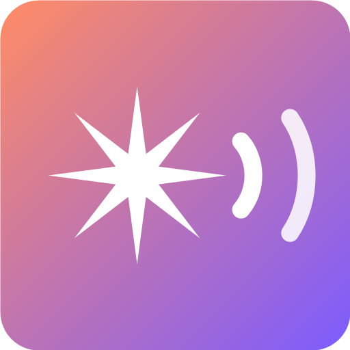
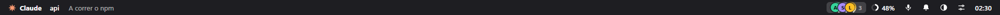
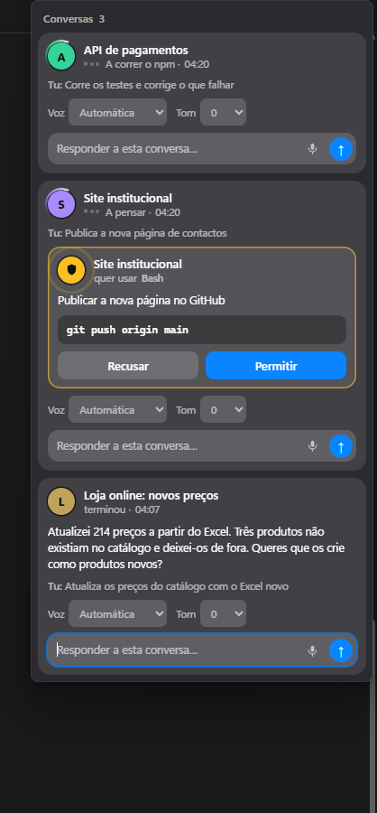
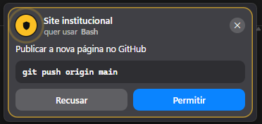
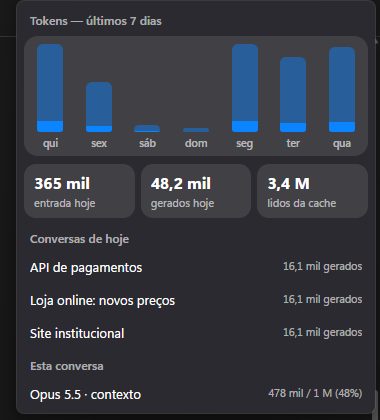
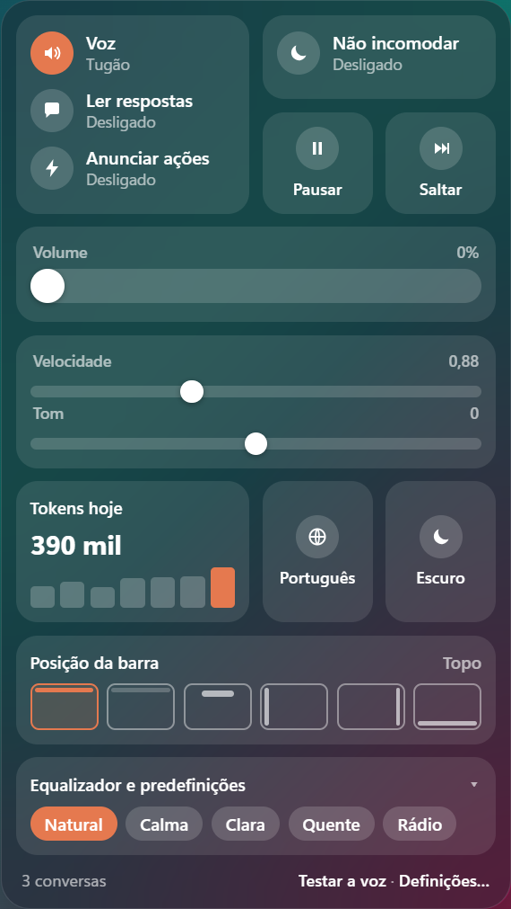
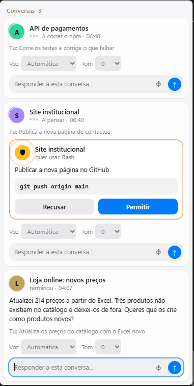
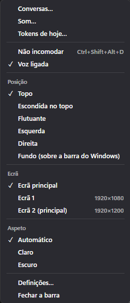

<p align="center"></p>

<h1 align="center">Voice for Claude Code</h1>

<p align="center"><a href="https://github.com/Gleite05/voz-claude-code/actions/workflows/testes.yml"></a> </p>

<p align="center">
  <a href="README.md">Português</a> · <b>English</b> · <a href="README.es.md">Español</a>
</p>

<p align="center">Claude Code talking to you in real time — European Portuguese by default, 11 languages available — plus a macOS-style menu bar for Windows to watch and reply to all your conversations.<br>Free, local, no accounts.</p>

<p align="center"></p>

> The bar and the spoken announcements come in **English, Spanish and Portuguese** and follow your Windows language (or pick one from the right-click menu). The bundled voice is Portuguese: for English, install `en_US-lessac-medium` with one click from the bar (or `/voz:vozes instalar en_US-lessac-medium`). Voices for French, German, Italian and more are in the catalog.

## What it does

- 🗣️ **Says what Claude is doing** — "editing config.ts", "running npm", "connecting to a remote server" — and **reads replies as they appear**, skipping code, tables and links.
- 💬 **Conversations in the bar** — an animated avatar per conversation (spinning = working, pulsing = needs you), the last message of each one and a box to **reply directly**.
- 🛡️ **Approve permissions from the bar** — the request shows up as a card with the exact command: *Allow* or *Deny*.
- 🎤 **Talk to Claude** — dictate your reply; Whisper transcribes it on your PC.
- 🌐 **English, Spanish and Portuguese interface** — the bar and the announcements follow your system language.
- 🌍 **Voices in 11 languages** — install more voices, pick a voice and pitch per conversation; replies in another language use that language's voice.
- 🌙 **Do not disturb** — a button (or a schedule, e.g. 22:00 → 08:00) with no voice and no pop-ups.
- 📊 **Tokens today** — a 7-day chart and the conversations that used the most.
- 🎚️ **Tunable sound** — volume, pitch, equalizer and presets.

| Conversations | Permission request and tokens | Control Center |
| :-: | :-: | :-: |
|  | <br><br> |  |

| Light mode | Right-click menu |
| :-: | :-: |
|  |  |

## Install

You need [Claude Code](https://code.claude.com) and [Node.js 20+](https://nodejs.org). In a terminal:

```bash
claude plugin marketplace add Gleite05/voz-claude-code
```

```bash
claude plugin install voz@voz
```

Restart Claude Code and run, inside it:

```
/voz:instalar tudo
```

This installs the **voice** (Piper + "tugão", pt-PT), **dictation** (Whisper) and, on Windows, the **bar**. Without Python, the installer downloads [uv](https://github.com/astral-sh/uv), which brings its own Python. For an English voice: `/voz:vozes catalogo en` then `/voz:vozes instalar en_US-lessac-medium` and `/voz:vozes padrao en_US-lessac-medium`.

**Bar requirements:** Windows 10/11 with WebView2 (built into Windows 11) and .NET Framework 4.8 (built into Windows). The bar is compiled on your PC — there are no executables in this repository.

## Use

**In the bar:** click the conversation name, the avatars, the context ring (tokens) or ⚟ (sound). **Right-click** anywhere: conversations, sound, tokens, do not disturb, **position** (top, auto-hide, floating, left, right, bottom), **screen**, theme, settings and close.

**Global shortcuts:** `Ctrl+Shift+Alt` + `V` talk · `P` pause · `N` skip · `C` conversations · `D` do not disturb.

**Commands:** `/voz:estado`, `/voz:ligar`, `/voz:desligar`, `/voz:parar`, `/voz:silencio`, `/voz:som`, `/voz:vozes`, `/voz:modo`, `/voz:barra`, `/voz:testar`. Options live in `~/.claude/voz/config.json` (e.g. `"idioma": "en"` — `auto`, `pt`, `en` or `es`).

## How it works

- Claude Code **hooks** (`PreToolUse`, `MessageDisplay` for live text, `Stop`, `Notification`, `PermissionRequest`) send events to a **local server** (one per user, over a pipe; starts on demand).
- The server decides what to say, synthesizes with **Piper** and serves the bar at `http://127.0.0.1:47821` (local only, token-protected).
- **Replying from the bar** uses a `Stop` hook with `asyncRewake`: it listens after each reply and wakes Claude with your message. In the conversation your reply shows up as a hook message.
- **Permissions:** in the Claude desktop app the hook runs alongside the normal dialog (whichever answers first wins). In the terminal it does not wait.
- **The bar** is a small C# host (`barra/anfitriao/VozBarra.cs`) with WebView2, docked like the taskbar, with Windows acrylic glass. It recompiles itself when the plugin updates.

## Privacy and security

- Everything runs on your computer: **no text, audio or data leaves your PC**. No telemetry.
- Network access only during installation: PyPI packages, voices from Hugging Face (MD5 checked), the Whisper model, `uv` (SHA-256 checked) and the WebView2 kit from NuGet (SHA-512 checked).
- The local server only listens on `127.0.0.1`, requires a random token stored in your user folder and checks the `Host` header (against DNS rebinding).

## Uninstall

`/voz:barra desinstalar`, then `claude plugin uninstall voz@voz`, then delete `~/.claude/voz`.

## License

[MIT](LICENSE) © 2026 Gleite05. Piper (GPL-3.0), faster-whisper (MIT), uv and WebView2 are downloaded by the installers and are not included here. Not an official Anthropic product.
