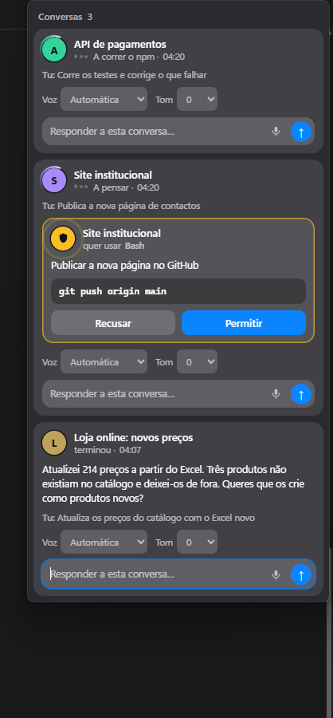
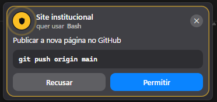

<p align="center"></p>

<h1 align="center">Voz para Claude Code</h1>

<p align="center"><a href="https://github.com/Gleite05/voz-claude-code/actions/workflows/testes.yml"></a> </p>

<p align="center">
  <a href="README.md">Português</a> · <a href="README.en.md">English</a> · <b>Español</b>
</p>

<p align="center">Claude Code hablándote en tiempo real — portugués de Portugal por defecto, 11 idiomas disponibles — y una barra al estilo de macOS en Windows para ver y responder a todas tus conversaciones.<br>Gratis, local y sin cuentas.</p>

<p align="center"></p>

> La barra y los avisos hablados están en **español, inglés y portugués** y siguen el idioma de Windows (o elige uno en el menú del clic derecho). La voz incluida es portuguesa: para español, instala `es_ES-davefx-medium` con un clic desde la barra (o `/voz:vozes instalar es_ES-davefx-medium`). En el catálogo hay voces en francés, alemán, italiano y más.

## Qué hace

- 🗣️ **Dice lo que Claude está haciendo** — «editando config.ts», «ejecutando npm» — y **lee las respuestas a medida que aparecen**, sin código, tablas ni enlaces.
- 💬 **Conversaciones en la barra** — un avatar animado por conversación (girando = trabajando, latiendo = te necesita), el último mensaje de cada una y una caja para **responder directamente**.
- 🛡️ **Aprobar permisos desde la barra** — la petición aparece en una tarjeta con el comando exacto: *Permitir* o *Rechazar*.
- 🎤 **Hablar con Claude** — dicta tu respuesta; Whisper la transcribe en tu PC.
- 🌐 **Interfaz en español, inglés y portugués** — la barra y los avisos siguen el idioma del sistema.
- 🌍 **Voces en 11 idiomas** — instala más voces, elige voz y tono para cada conversación.
- 🌙 **No molestar** — un botón (o un horario, p. ej. 22:00 → 08:00) sin voz ni avisos.
- 📊 **Tokens del día** — gráfico de 7 días y las conversaciones que más consumieron.
- 🎚️ **Sonido ajustable** — volumen, tono, ecualizador y preajustes.

| Conversaciones | Permisos y tokens | Centro de Control |
| :-: | :-: | :-: |
|  | <br><br> |  |

## Instalar

Necesitas [Claude Code](https://code.claude.com) y [Node.js 20+](https://nodejs.org). En una terminal:

```bash
claude plugin marketplace add Gleite05/voz-claude-code
```

```bash
claude plugin install voz@voz
```

Reinicia Claude Code y ejecuta, dentro de él:

```
/voz:instalar tudo
```

Instala la **voz** (Piper), el **dictado** (Whisper) y, en Windows, la **barra**. Sin Python, el instalador descarga [uv](https://github.com/astral-sh/uv), que trae su propio Python. Para una voz en español: `/voz:vozes catalogo es` y luego `/voz:vozes instalar es_ES-davefx-medium` y `/voz:vozes padrao es_ES-davefx-medium`.

**Requisitos de la barra:** Windows 10/11 con WebView2 (incluido en Windows 11) y .NET Framework 4.8 (incluido en Windows). La barra se compila en tu PC — no hay ejecutables en este repositorio.

## Uso

**En la barra:** haz clic en el nombre de la conversación, en los avatares, en el anillo de contexto (tokens) o en ⚟ (sonido). **Clic derecho** en cualquier punto: conversaciones, sonido, tokens, no molestar, **posición** (arriba, oculta, flotante, izquierda, derecha, abajo), **pantalla**, tema, ajustes y cerrar.

**Atajos globales:** `Ctrl+Shift+Alt` + `V` hablar · `P` pausar · `N` saltar · `C` conversaciones · `D` no molestar.

## Privacidad y seguridad

- Todo funciona en tu ordenador: **ningún texto, audio o dato sale de tu PC**. Sin telemetría.
- Acceso a la red solo durante la instalación (PyPI, Hugging Face con MD5, `uv` con SHA-256, WebView2 de NuGet con SHA-512).
- El servidor local solo escucha en `127.0.0.1`, exige un token aleatorio y comprueba la cabecera `Host`.

## Desinstalar

`/voz:barra desinstalar`, luego `claude plugin uninstall voz@voz` y borra `~/.claude/voz`.

## Licencia

[MIT](LICENSE) © 2026 Gleite05. Piper (GPL-3.0), faster-whisper (MIT), uv y WebView2 se descargan con los instaladores y no se incluyen aquí. No es un producto oficial de Anthropic.
