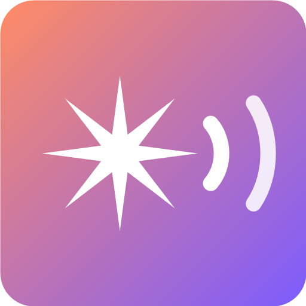
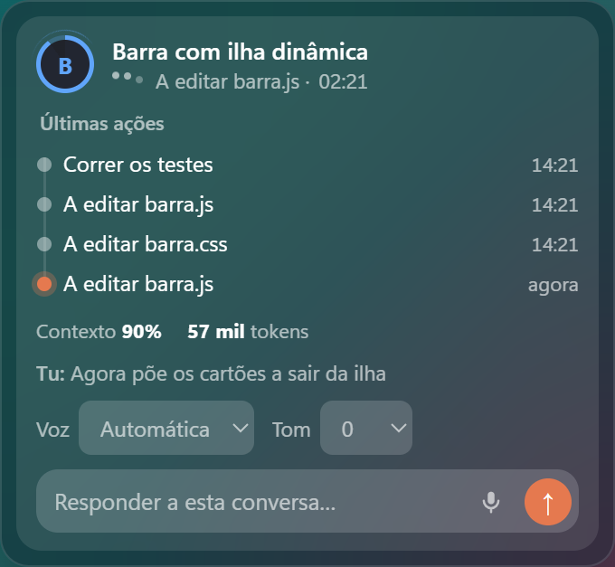
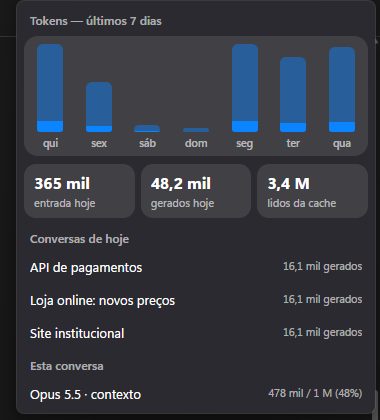
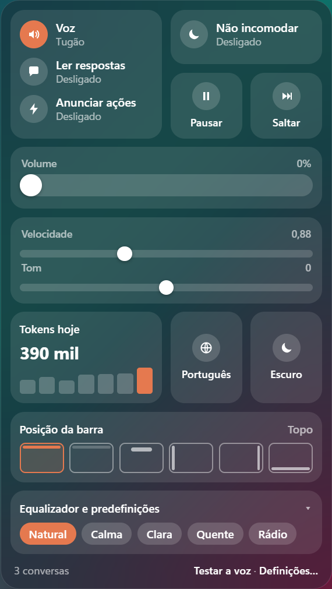

<p align="center"></p>

<h1 align="center">Voz para Claude Code</h1>

<p align="center"><a href="https://github.com/Gleite05/voz-claude-code/actions/workflows/testes.yml"></a> </p>

<p align="center">
  <a href="README.md">Português</a> · <a href="README.en.md">English</a> · <b>Español</b>
</p>

<p align="center">Claude Code hablándote en tiempo real — portugués de Portugal por defecto, 11 idiomas disponibles — y una barra al estilo de macOS en Windows para ver y responder a todas tus conversaciones.<br>Gratis, local y sin cuentas.</p>

<p align="center"></p>

> La barra y los avisos hablados están en **español, inglés y portugués** y siguen el idioma de Windows (o elige uno en el menú del clic derecho). La voz incluida es portuguesa: para español, instala `es_ES-davefx-medium` con un clic desde la barra (o `/voz:vozes instalar es_ES-davefx-medium`). En el catálogo hay voces en francés, alemán, italiano y más.

## Qué hace

- 🗣️ **Dice lo que Claude está haciendo** — «editando config.ts», «ejecutando npm» — y **lee las respuestas a medida que aparecen**, sin código, tablas ni enlaces.
- 💬 **Conversaciones en la barra** — un avatar animado por conversación (girando = trabajando, latiendo = te necesita), el último mensaje de cada una y una caja para **responder directamente**.
- ✅ **Dice cómo fue** — «Las 38 pruebas pasaron», «La compilación falló», «Push hecho», comandos largos con su duración; la isla se pone roja cuando algo importante falla y muestra un **cronómetro** mientras corre un comando.
- 📋 **Progreso de tareas y subagentes** — el anillo «4/7» de la lista de tareas, los asistentes orbitando el avatar de la conversación y el aviso cuando se compacta.
- 🛡️ **Aprobar permisos desde la barra** — la petición aparece en una tarjeta con el comando exacto o el **diff en color** de lo que va a cambiar: *Permitir*, *Rechazar* o **«Siempre»** (la regla que sugiere el propio Claude Code, p. ej. `git push:*`).
- 🎧 **Manos libres y aprobar por voz** — tras cada respuesta la barra te escucha y envía lo que digas (para sola cuando te callas); en las peticiones de permiso pregunta «¿Lo permites?» y entiende «sí», «no» o «siempre». Desactivados por defecto.
- 🎨 **Cinco diseños** — vidrio líquido, esmerilado o clásico al estilo macOS, o Mica y Acrílico al estilo Windows 11 (iconos y color de énfasis de Windows), elegidos con un clic en el panel *Diseño*.
- 🫧 **Vidrio líquido** — la barra anclada refracta tu fondo de verdad (lente en los bordes, dispersión, brillo en el borde), con un panel *Material* para ajustarlo o volver al clásico.
- 🔔 **Sonidos y sonido espacial** — sonidos cortos para pasó, falló, permiso y terminó; con varias conversaciones, cada una habla desde su lado.
- 🤫 **Callada en reuniones** — con el micrófono ocupado por otra app (Teams, Zoom…) o algo a pantalla completa, la voz se calla sola.
- 👋 **«Mientras estabas fuera»** — al volver al ordenador te dice qué terminó, qué falló y qué te necesita.
- 💶 **Coste en euros y «Tu semana»** — cuánto costarían los tokens en la API (tasa del BCE) y una tarjeta semanal (horas, conversaciones, proyectos, herramientas) para copiar como imagen.
- 🎤 **Hablar con Claude** — dicta tu respuesta; Whisper la transcribe en tu PC.
- 🏝️ **Isla dinámica** — una cápsula de cristal en el centro de la barra muestra la acción, los subtítulos mientras habla, las peticiones de permiso y cuándo termina una conversación.
- 🌐 **Interfaz en español, inglés y portugués** — la barra y los avisos siguen el idioma del sistema.
- 🌍 **Voces en 11 idiomas** — instala más voces, elige voz y tono para cada conversación.
- 🌙 **No molestar** — un botón (o un horario, p. ej. 22:00 → 08:00) sin voz ni avisos.
- 📊 **Tokens del día** — gráfico de 7 días y las conversaciones que más consumieron.
- 🎚️ **Sonido ajustable** — volumen, tono, ecualizador y preajustes.

<p align="center"></p>

| Conversación | Permisos y tokens | Centro de Control |
| :-: | :-: | :-: |
|  | <br><br> |  |

## Instalar

Necesitas [Claude Code](https://code.claude.com) y [Node.js 20+](https://nodejs.org). En una terminal:

```bash
claude plugin marketplace add Gleite05/voz-claude-code
```

```bash
claude plugin install voz@voz
```

Reinicia Claude Code y ejecuta, dentro de él:

```
/voz:instalar tudo
```

Instala la **voz** (Piper), el **dictado** (Whisper) y, en Windows, la **barra**. Sin Python, el instalador descarga [uv](https://github.com/astral-sh/uv), que trae su propio Python. Para una voz en español: `/voz:vozes catalogo es` y luego `/voz:vozes instalar es_ES-davefx-medium` y `/voz:vozes padrao es_ES-davefx-medium`.

La barra también se cambia con tus propias palabras («pon la barra abajo», «vidrio más transparente», «quita el reloj»): la skill `barra` se encarga (o usa `/voz:barra ajustes`).

**Requisitos de la barra:** Windows 10/11 con WebView2 (incluido en Windows 11) y .NET Framework 4.8 (incluido en Windows). La barra se compila en tu PC — no hay ejecutables en este repositorio.

## Uso

**En la barra:** haz clic en el nombre de la conversación, en los avatares, en el anillo de contexto (tokens) o en ⚟ (sonido). **Clic derecho** en cualquier punto: conversaciones, sonido, tokens, no molestar, **posición** (arriba, oculta, flotante, izquierda, derecha, abajo), **pantalla**, tema, ajustes y ocultar. **Oculta, la barra deja un icono naranja en el área de notificación** (junto al reloj; en Windows 11 puede estar dentro de la flecha ˄ — arrástralo a la barra de tareas para tenerlo siempre a la vista): un clic la vuelve a mostrar; con el clic derecho tienes «No molestar» y «Salir de la barra».

**Atajos globales:** `Ctrl+Shift+Alt` + `V` hablar · `P` pausar · `N` saltar · `C` conversaciones · `D` no molestar.

## Privacidad y seguridad

- Todo funciona en tu ordenador: **ningún texto, audio o dato sale de tu PC**. Sin telemetría.
- Acceso a la red solo durante la instalación (PyPI, Hugging Face con MD5, `uv` con SHA-256, WebView2 de NuGet con SHA-512).
- Tras la instalación, el único acceso a la red es la **tasa de cambio del Banco Central Europeo** (pública, una vez al día, sin enviar nada) para mostrar el coste en euros.
- El micrófono solo se usa al pulsar 🎤/el atajo, o tras cada respuesta y en las peticiones de permiso si activas **manos libres** o **aprobar por voz** (desactivados por defecto). La transcripción es local.
- El servidor local solo escucha en `127.0.0.1`, exige un token aleatorio y comprueba la cabecera `Host`.

## Desinstalar

`/voz:barra desinstalar`, luego `claude plugin uninstall voz@voz` y borra `~/.claude/voz`.

## Licencia

[MIT](LICENSE) © 2026 Gleite05. Piper (GPL-3.0), faster-whisper (MIT), uv y WebView2 se descargan con los instaladores y no se incluyen aquí. No es un producto oficial de Anthropic.
