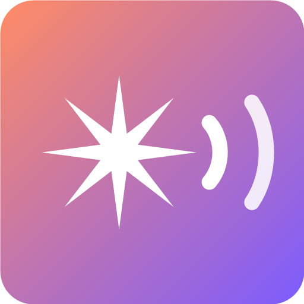
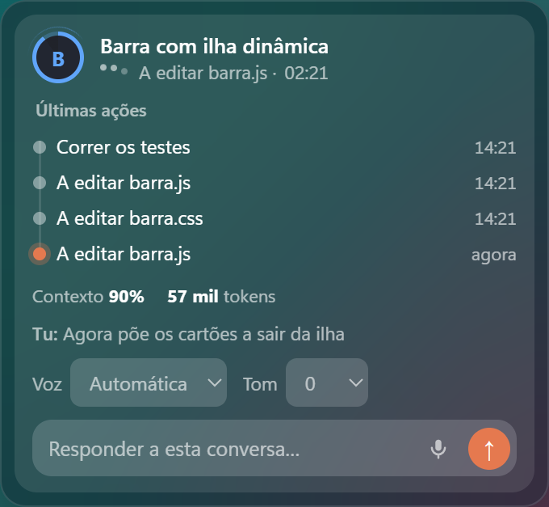
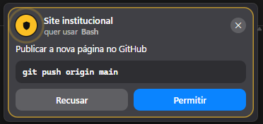
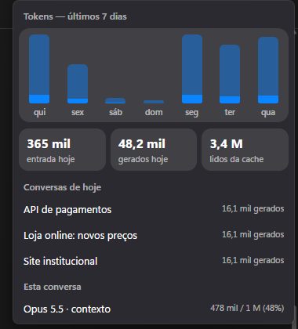
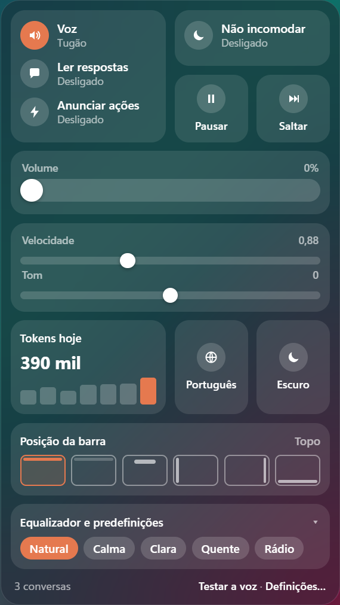
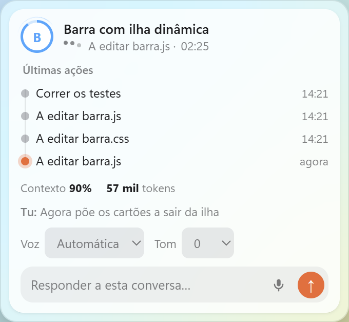
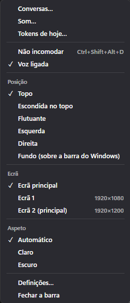

<p align="center"></p>

<h1 align="center">Voz para o Claude Code</h1>

<p align="center"><a href="https://github.com/Gleite05/voz-claude-code/actions/workflows/testes.yml"></a> </p>

<p align="center">
  <b>Português</b> · <a href="README.en.md">English</a> · <a href="README.es.md">Español</a>
</p>

<p align="center">O Claude Code a falar contigo em <b>português de Portugal</b>, em tempo real — e uma barra no topo do Windows, ao estilo do macOS, para veres e responderes a todas as conversas.<br>Gratuito, local e sem contas.</p>

<p align="center"></p>

## O que faz

- 🏝️ **Ilha dinâmica** — uma cápsula de vidro no centro da barra mostra a ação, a legenda enquanto fala, os pedidos de autorização e quando uma conversa termina.
- 🗣️ **Diz o que o Claude está a fazer** — «A editar config.ts», «A correr o npm», «A ligar a um servidor remoto» — e **lê as respostas enquanto aparecem**, sem código, tabelas nem links.
- 💬 **Conversas na barra** — um avatar com anel por conversa (o anel enche com o contexto, roda enquanto trabalha e pulsa quando precisa de ti); clica nele para veres as últimas ações e **responderes diretamente**.
- ✅ **Diz como correu** — «Os 38 testes passaram», «A compilação falhou», «Push feito», comandos longos com a duração; a ilha fica vermelha quando algo importante falha e mostra um **cronómetro** enquanto um comando corre.
- 📋 **Progresso das tarefas e sub-agentes** — o anel «4/7» da lista de tarefas, os assistentes a orbitar o avatar da conversa e o aviso quando a conversa é compactada.
- 🛡️ **Aprovar permissões pela barra** — o pedido aparece num cartão com o comando exato ou o **diff colorido** do que vai mudar: *Permitir*, *Recusar* ou **«Sempre»** (a regra que o próprio Claude Code sugere, ex.: `git push:*`).
- 🎧 **Mãos-livres e autorizar por voz** — depois de cada resposta a barra ouve-te e envia o que disseres (pára sozinha quando te calas); nos pedidos de autorização pergunta «Autorizas?» e percebe «sim», «não» ou «sempre». Desligados por omissão.
- 🎤 **Falar com o Claude** — dita a resposta; o Whisper transcreve no teu PC.
- 🔔 **Sons e som espacial** — sons curtos para «passou», «falhou», «autorização» e «terminou»; com várias conversas, cada uma fala do seu lado (esquerda, centro, direita).
- 🤫 **Calada nas reuniões** — com o microfone ocupado por outra app (Teams, Zoom…) ou um programa em ecrã inteiro, a voz cala-se sozinha.
- 👋 **«Enquanto estiveste fora»** — quando voltas ao computador, diz o que terminou, o que falhou e o que precisa de ti.
- 💶 **Custo em euros e «A tua semana»** — quanto custariam os tokens na API (taxa do BCE) e um cartão da semana (horas, conversas, projetos, ferramentas) para copiares como imagem.
- 🌍 **Vozes de 11 idiomas** — instala mais vozes, escolhe uma voz e um tom para cada conversa, e as respostas noutro idioma usam a voz desse idioma.
- 🌐 **Interface em português, inglês e espanhol** — a barra e as frases faladas seguem a língua do Windows (ou a que escolheres no clique direito).
- 🌙 **Não incomodar** — um botão (ou um horário, ex.: 22:00 → 08:00) sem voz nem avisos.
- 📊 **Tokens do dia** — gráfico dos últimos 7 dias, o custo e as conversas que mais gastaram.
- 🎚️ **Som afinável** — volume, altura, equalizador e predefinições (natural, calma, clara, quente, rádio).

<p align="center"></p>

| Conversa | Pedido de autorização e tokens | Centro de Controlo |
| :-: | :-: | :-: |
|  | <br><br> |  |

<p align="center"></p>

| Modo claro | Clique direito |
| :-: | :-: |
|  |  |

## Instalar

Precisas do [Claude Code](https://code.claude.com) e do [Node.js 20+](https://nodejs.org). No terminal:

```bash
claude plugin marketplace add Gleite05/voz-claude-code
```

```bash
claude plugin install voz@voz
```

Reinicia o Claude Code e corre, dentro dele:

```
/voz:instalar tudo
```

Isto instala a **voz portuguesa** (Piper + «tugão»), o **ditado** (Whisper) e, no Windows, a **barra**. Se não tiveres Python, o instalador descarrega o [uv](https://github.com/astral-sh/uv), que traz o seu próprio Python. Também podes instalar por partes: `/voz:instalar voz`, `/voz:instalar ouvir`, `/voz:barra instalar`.

**Requisitos da barra:** Windows 10/11 com o WebView2 (já vem no Windows 11) e o .NET Framework 4.8 (vem no Windows). A barra é compilada no teu PC — não há executáveis neste repositório.

## Usar

**Na barra:** clica no nome da conversa, nos avatares, no anel do contexto (tokens) ou no ⚟ (som). **Clique direito** em qualquer ponto: conversas, som, tokens, não incomodar, **posição** (topo, escondida, flutuante, esquerda, direita, fundo), **ecrã**, aspeto, definições e esconder. **Escondida, a barra fica com um ícone laranja na área de notificação** (ao pé do relógio; no Windows 11 pode estar dentro da seta ˄ — arrasta-o para a barra de tarefas para ficar sempre à vista): um clique mostra-a outra vez, o clique direito tem «Não incomodar» e «Sair da barra». Na estrela: definições completas (módulos visíveis e ordem, vozes, horário de silêncio, arranque com o Windows / só com o Claude Code / à mão).

**Atalhos** (em qualquer lado): `Ctrl+Shift+Alt` + `V` falar · `P` pausar · `N` saltar · `C` conversas · `D` não incomodar.

**Comandos:**

| Comando | O que faz |
| --- | --- |
| `/voz:estado` | Estado e opções |
| `/voz:ligar` · `/voz:desligar` · `/voz:parar` | Liga, desliga, cala agora |
| `/voz:silencio ligar\|desligar\|horario 22:00 08:00` | Não incomodar |
| `/voz:som [graves 3 \| altura -1 \| calma …]` | Afinar o som |
| `/voz:vozes [catalogo pt \| instalar <id> \| padrao <id>]` | Vozes e idiomas |
| `/voz:modo tudo\|acoes\|respostas` | O que é dito |
| `/voz:barra ligar\|desligar\|posicao …\|arranque …` | A barra |
| `/voz:testar [texto]` | Frase de teste |

As opções ficam em `~/.claude/voz/config.json` (ex.: `idioma` — `auto`, `pt`, `en` ou `es`; `pronuncias` para corrigir a pronúncia de palavras — «Claude» lê-se «Cláude»).

## Como funciona

- **Ganchos** do Claude Code (`PreToolUse`/`PostToolUse`/`PostToolUseFailure`, `MessageDisplay` para o texto em tempo real, `SubagentStart`/`SubagentStop`, `PreCompact`/`PostCompact`, `Stop`, `Notification`, `PermissionRequest`) enviam os eventos para um **servidor local** (um por utilizador, por um pipe; arranca sozinho).
- O servidor decide o que dizer, sintetiza com o **Piper** (a frase seguinte prepara-se enquanto a atual toca) e serve a barra em `http://127.0.0.1:47821` (só local, com token).
- **Responder pela barra** usa um gancho `Stop` com `asyncRewake`: no fim de cada resposta fica à escuta e, quando escreves na barra, o Claude acorda com a tua mensagem. Na conversa, a tua resposta aparece como mensagem do gancho.
- **Permissões:** na app do Claude, o gancho corre ao lado do diálogo normal (vale quem decidir primeiro). No terminal não espera (para não atrasar o diálogo).
- **Sons** gerados no próprio PC (não há ficheiros de áudio no repositório); o som espacial passa a voz do Piper a estéreo.
- **Reuniões e regresso:** o anfitrião da barra vê se outra app está a usar o microfone (o registo de privacidade do Windows), se há um programa em ecrã inteiro e há quanto tempo não mexes no rato nem no teclado.
- **A barra** é um anfitrião pequeno em C# (`barra/anfitriao/VozBarra.cs`) com a WebView2, encaixado no ecrã como a barra de tarefas, com o vidro acrílico do Windows. Recompila-se sozinha quando o plugin atualiza.

## Privacidade e segurança

- Tudo corre no teu computador: **nenhum texto, áudio ou dado sai do PC**. Sem telemetria.
- Acessos à rede só nos instaladores: `piper-tts`, `faster-whisper` e `sounddevice` (PyPI), vozes (Hugging Face, `rhasspy/piper-voices`, MD5 verificado), modelo Whisper (Hugging Face), `uv` (GitHub, SHA-256 verificado) e o kit WebView2 (NuGet, SHA-512 verificado).
- Depois de instalado, o único acesso à rede é a **taxa de câmbio do Banco Central Europeu** (pública, uma vez por dia, sem enviar nada), para mostrar o custo em euros.
- O microfone só é usado quando carregas no 🎤/atalho, ou depois de cada resposta e nos pedidos de autorização se ligares o **mãos-livres** ou o **autorizar por voz** (desligados por omissão). A transcrição é local.
- O servidor local só aceita ligações de `127.0.0.1`, exige um token aleatório guardado na tua pasta de utilizador e verifica o cabeçalho `Host` (contra *DNS rebinding*).
- A barra lê do histórico local (`~/.claude/projects`) apenas o título das conversas, a contagem de tokens, o modelo, a pasta e o nome das ferramentas usadas (para o custo e «A tua semana»).

## Limites conhecidos

- A voz pt-PT é a melhor gratuita e local que existe hoje («tugão», Piper); não é tão natural como uma voz paga.
- A barra é só para Windows; a voz funciona em macOS e Linux mas está pouco testada.
- No mãos-livres, para interromper a voz usa o atalho ou o 🎤: falar por cima seria apanhado pelo próprio microfone.
- O custo é uma estimativa ao preço público da API; com uma subscrição (Pro/Max) não pagas isto.
- Cada conversa parada deixa um pequeno processo `node` à escuta de respostas (até 12 h).

## Desinstalar

```
/voz:barra desinstalar
```

```bash
claude plugin uninstall voz@voz
```

Depois apaga a pasta `~/.claude/voz` (vozes, Python, barra e configuração).

## Licença e créditos

- Este projeto: [MIT](LICENSE) © 2026 Gleite05.
- [Piper](https://github.com/OHF-Voice/piper1-gpl) (GPL-3.0), [faster-whisper](https://github.com/SYSTRAN/faster-whisper) (MIT), [uv](https://github.com/astral-sh/uv) (MIT/Apache-2.0) e [WebView2](https://www.nuget.org/packages/Microsoft.Web.WebView2) (Microsoft) — descarregados pelos instaladores, não incluídos neste repositório.
- Vozes do [piper-voices](https://huggingface.co/rhasspy/piper-voices) (cada voz tem a sua licença; a «tugão» usa dados CC0).
- Não é um produto oficial da Anthropic.
